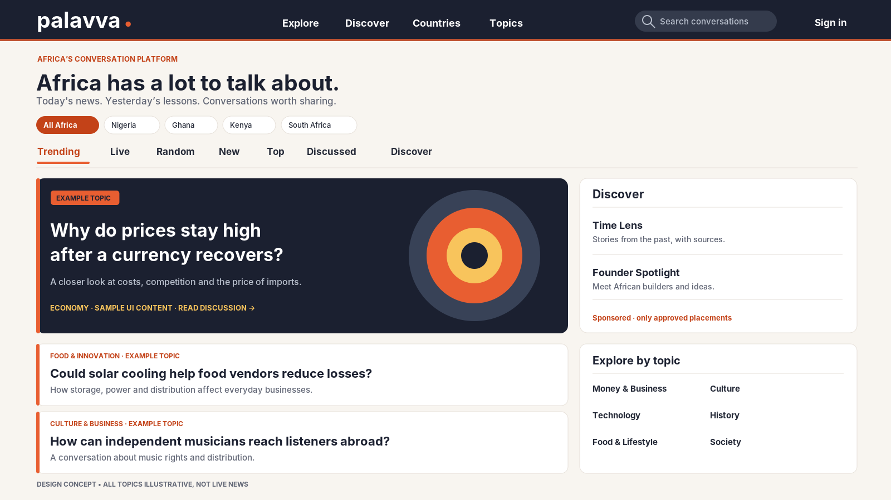
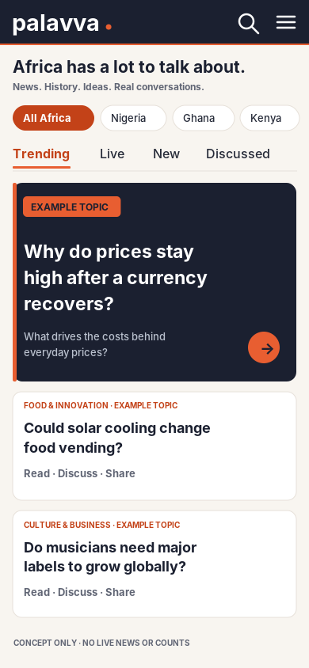
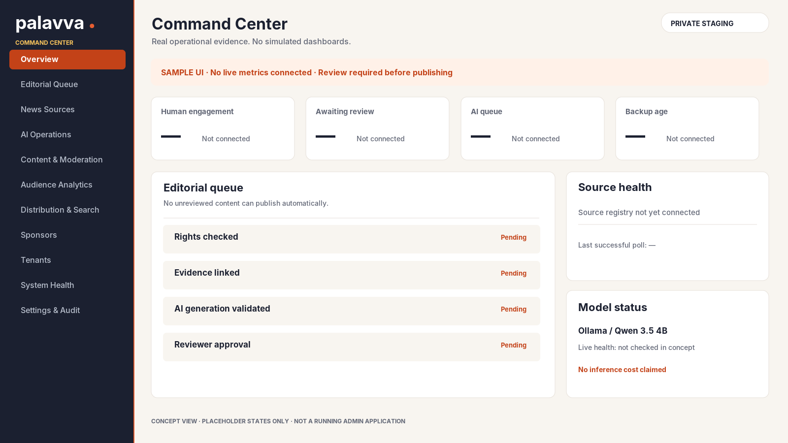
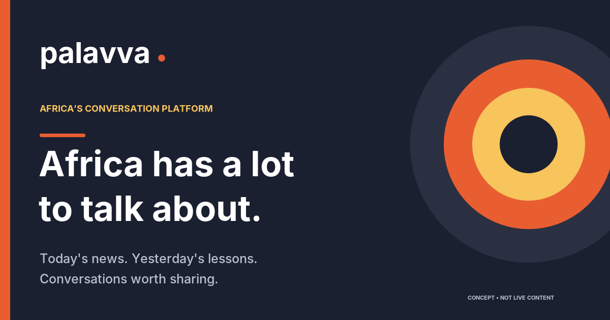

# Palavva Midnight + Tangerine visual concept starters

**Approved palette:** Midnight `#1B2030`, Tangerine `#E85E31`, Warm Gold `#F8C45C`, Ivory `#F8F5F0`. Older forest-green assets are obsolete and replaced in this package. Buttons with white labels use accessible darker Tangerine `#C34218`.

These **six** vector-first drafts are supplied as creative development references and reusable technical starting points. Each exists as an editable `.svg` plus `.png` render. The color direction is founder-approved, while the composition/logotype refinements remain **drafts**. They are **not final approved brand designs, not functional screens and not images of real current events**. The 18 full screen-by-screen visual briefs are in `../15-VISUAL-ASSET-BRIEFS.md`.

| Concept | Files | Application |
| --- | --- | --- |
| Wordmark | `palavva-wordmark-draft.svg`, `.png` | Spelling/typographic starter |
| Icon/favicon | `palavva-mark-draft.svg`, `.png` | Stylized `p` and conversation symbol |
| Default share card | `palavva-default-og-draft.svg`, `.png` | 1200×630 Open Graph fallback |
| Desktop homepage | `palavva-desktop-concept.svg`, `.png` | Feed-first 1600×900 layout |
| Mobile homepage | `palavva-mobile-concept.svg`, `.png` | Feed-first 390×844 layout |
| Command Center | `palavva-admin-concept.svg`, `.png` | 1600×900 evidence-oriented admin |

## Concept previews

## Asset acceptance

Final art requires brand approval, tested dark/light and responsive variants, text/contrast checks, licenses and alt descriptions, and real implemented screen captures after working code exists. Do not use concept labels as publisher identities, change `Sample UI` into falsely current news, or claim that a working app is depicted.
